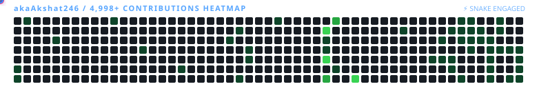

<div align="center">

<!-- HEADER WAVE ANIMATION -->


<!-- DYNAMIC TYPING SVG -->
<p align="center">
  
</p>

<!-- STATUS PILLS & VISITOR COUNTER -->
<p align="center">
  
  
  
  
</p>

<!-- QUICK NAVIGATION -->
<p align="center">
  <a href="#about-me"><b>[ About ]</b></a> •
  <a href="#contribution-snake-game"><b>[ Contribution Heatmap ]</b></a> •
  <a href="#featured-projects"><b>[ Featured Projects ]</b></a> •
  <a href="#tech-stack-arsenal"><b>[ Tech Arsenal ]</b></a> •
  <a href="#github-metrics--activity"><b>[ Activity ]</b></a> •
  <a href="#hackathons--achievements"><b>[ Achievements ]</b></a> •
  <a href="#connect"><b>[ Connect ]</b></a>
</p>
</div>

## About Me

```bash
┌──(akshat㉿vats)-[~/portfolio]
└─$ cat profile.json
```

```json
{
  "name": "Akshat Vats",
  "handle": "@akaAkshat246",
  "quote": "Ditch ordinary, choose phenomenal",
  "location": "India",
  "current_focus": [
    "Predictive Healthcare Resource Intelligence",
    "High-speed Edge Microservices on Cloudflare Workers",
    "Autonomous Campus Systems and Real-time Web Applications"
  ],
  "philosophy": "Writing clean, scalable code with tactile aesthetics that users remember."
}
```

## Contribution Snake Game

<p align="center">
  <b>Watch the snake navigate the 4,900+ contribution matrix.</b>
</p>

<div align="center">
  <picture>
    <source media="(prefers-color-scheme: dark)" srcset="https://raw.githubusercontent.com/akaAkshat246/akaAkshat246/output/github-contribution-grid-snake-dark.svg">
    <source media="(prefers-color-scheme: light)" srcset="https://raw.githubusercontent.com/akaAkshat246/akaAkshat246/output/github-contribution-grid-snake.svg">
    
  </picture>
</div>

> **Automation**: Powered by `platane/snk` via GitHub Actions `.github/workflows/snake.yml`. It regenerates automatically every 12 hours with fresh live commits.

## Featured Projects

<table>
  <thead>
    <tr>
      <th width="30%">Project</th>
      <th width="45%">Description and Key Innovations</th>
      <th width="25%">Links and Tech</th>
    </tr>
  </thead>
  <tbody>
    <tr>
      <td>
        <b>AarogyaGrid AI</b><br/>
        <sub>Healthcare Resource Intelligence</sub>
      </td>
      <td>
        Predictive healthcare resource management platform leveraging AI, data engineering, and Google Cloud to forecast hospital bed and critical resource demand.
      </td>
      <td>
        <a href="https://aarogya-grid-ai-alpha.vercel.app/" target="_blank">
          
        </a>
        <a href="https://github.com/akaAkshat246/AarogyaGrid-AI" target="_blank">
          
        </a><br/>
        <code>React</code> <code>GCP</code> <code>AI/ML</code> <code>Node.js</code>
      </td>
    </tr>
    <tr>
      <td>
        <b>ABES Event Nexus</b><br/>
        <sub>Autonomous Campus Ecosystem</sub>
      </td>
      <td>
        Unified event management and engagement platform built for ABES Engineering College, featuring real-time registrations, schedules, and student interaction.
      </td>
      <td>
        <a href="https://abes-nexus.onrender.com" target="_blank">
          
        </a>
        <a href="https://github.com/akaAkshat246/ABES-Event-Nexus" target="_blank">
          
        </a><br/>
        <code>TypeScript</code> <code>Node.js</code> <code>REST</code>
      </td>
    </tr>
    <tr>
      <td>
        <b>Koko AI (haX-Baby)</b><br/>
        <sub>3D Baby Panda Companion</sub>
      </td>
      <td>
        Interactive 3D virtual companion powered by real-time WebGL rendering and conversational intelligence.
      </td>
      <td>
        <a href="https://ha-x-baby-ten.vercel.app/" target="_blank">
          
        </a>
        <a href="https://github.com/akaAkshat246/haX-Baby" target="_blank">
          
        </a><br/>
        <code>Next.js</code> <code>Three.js</code> <code>TypeScript</code> <code>AI</code>
      </td>
    </tr>
    <tr>
      <td>
        <b>Brawnsterdam (AVS DA GR8)</b><br/>
        <sub>Edge Telemetry and Cloud Engine</sub>
      </td>
      <td>
        Low-latency serverless web application engineered directly onto Cloudflare Workers edge network with instantaneous response times.
      </td>
      <td>
        <a href="https://brawnsterdam.akshatavs1122.workers.dev/" target="_blank">
          
        </a>
        <a href="https://github.com/akaAkshat246/Brawnsterdam" target="_blank">
          
        </a><br/>
        <code>Cloudflare Workers</code> <code>JavaScript</code> <code>Edge</code>
      </td>
    </tr>
    <tr>
      <td>
        <b>Debug Assistant</b><br/>
        <sub>AI Diagnostic and Code Resolver</sub>
      </td>
      <td>
        Automated AI-assisted code debugging assistant that diagnoses stack traces, pinpoints logic flaws, and synthesizes tested patches.
      </td>
      <td>
        <a href="https://debug-assistant-5g7p.onrender.com" target="_blank">
          
        </a><br/>
        <code>Python</code> <code>AI/LLM</code> <code>Diagnostic Engine</code>
      </td>
    </tr>
    <tr>
      <td>
        <b>EcoScore Extension</b><br/>
        <sub>Sustainable Shopping Intelligence</sub>
      </td>
      <td>
        Chrome browser extension delivering real-time environmental footprint analysis and sustainable alternatives while shopping online. <b>16+ Community Stars</b>.
      </td>
      <td>
        <a href="https://github.com/akaAkshat246/EcoScore-Browser-Extension" target="_blank">
          
        </a><br/>
        <code>JavaScript</code> <code>Chrome API</code> <code>Manifest V3</code>
      </td>
    </tr>
    <tr>
      <td>
        <b>MoodScape</b><br/>
        <sub>Interactive Sensory Canvas</sub>
      </td>
      <td>
        Immersive audio-visual sensory moodscape designed with creative algorithms, fluid canvas interactions, and ambient soundscapes.
      </td>
      <td>
        <a href="https://akaakshat246.github.io/my-project/" target="_blank">
          
        </a>
        <a href="https://github.com/akaAkshat246/my-project" target="_blank">
          
        </a><br/>
        <code>Canvas API</code> <code>Audio FX</code> <code>JavaScript</code>
      </td>
    </tr>
    <tr>
      <td>
        <b>Experiential Creations</b><br/>
        <sub>Festive Interactive Showcase</sub>
      </td>
      <td>
        High-fidelity festive web experiences featuring particle physics, particle fireworks, and interactive touch responses.
      </td>
      <td>
        <a href="https://janamashtamii.netlify.app" target="_blank">
          
        </a>
        <a href="https://github.com/akaAkshat246/Merry_Christmas" target="_blank">
          
        </a><br/>
        <code>CSS Keyframes</code> <code>Particle Canvas</code> <code>HTML5</code>
      </td>
    </tr>
  </tbody>
</table>

## Tech Stack Arsenal

<div align="center">

<p align="center">
  <b>Languages and Core</b><br/>
  
</p>

<p align="center">
  <b>Frontend Engineering</b><br/>
  
</p>

<p align="center">
  <b>Backend, Cloud and Edge</b><br/>
  
</p>

<p align="center">
  <b>Databases and DevOps Tools</b><br/>
  
</p>

</div>

## GitHub Metrics & Activity

<div align="center">

  <!-- OVERVIEW & TOP LANGUAGES -->
  <table border="0" align="center">
    <tr align="center">
      <td>
        
      </td>
      <td>
        
      </td>
    </tr>
  </table>

  <!-- STREAK STATS -->
  <br/>
  

</div>

## Hackathons & Achievements

<details open>
<summary><b>Click to Toggle Hackathons and Notable R&D</b></summary>
<br/>

- **IBM BOB Hackathon 2026** — Enterprise solution architecture and high-impact fintech prototype.
- **Snapdragon AI Lab Challenge 2026** — Edge AI model deployment and on-device neural acceleration.
- **Smart India Hackathon (SIH26038)** — *Explainable AI-Powered Diabetic Retinopathy Screening Platform* for rural healthcare diagnostics.
- **EcoScore Browser Extension** — Community-favorite browser extension with 16+ GitHub stars for environmental transparency.
- **NIRMAAN** — AI-Driven Automated Waste Collection and Segregation Platform.

</details>

<details>
<summary><b>Developer Terminal Mode</b></summary>
<br/>

```text
 _________________________________________
/ "Ditch ordinary, choose phenomenal."    \
\                   — Akshat Vats         /
 -----------------------------------------
        \   ^__^
         \  (oo)\_______
            (__)\       )\/\
                ||----w |
                ||     ||
```

- **Favorite Quote**: *"The best way to predict the future is to invent it."*
- **Fuel**: Espresso and night-owl focus.
- **On Repeat**: Synthwave and Lo-Fi coding frequencies.

</details>

## Connect

<p align="center">
  <a href="https://www.linkedin.com/in/akshat-vats-b6b1692b6/" target="_blank">
    
  </a>
  &nbsp;
  <a href="mailto:akshatavs1122@gmail.com">
    
  </a>
  &nbsp;
  <a href="https://www.instagram.com/who_akshatvats?obrf=MWN1N3p3c3FiMmlpMA==" target="_blank">
    
  </a>
</p>

<br/>

<!-- FOOTER WAVE ANIMATION -->
<div align="center">
  
  <p align="center">
    <sub>Akshat Vats • <b>Ditch ordinary, choose phenomenal.</b></sub>
  </p>
</div>
